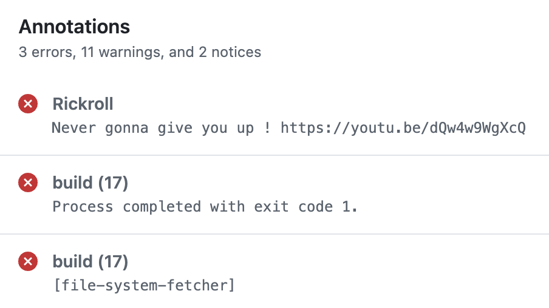

# Tâche 3 : automatisation des tests de sécurité

## 1. Workflow GitHub Actions

### Ce qu'on a fait

Avec l'aide d'une IA (Claude), on a ajouté une tâche `semgrep` dans `.github/workflows/main-jdk17-build.yml`. 

### Problèmes rencontrés

À compléter si nécessaire

## 2. Rickroll

Avec l'aide d'une IA (Claude), on a créé l'action[.github/actions/rickroll/action.yml](.github/actions/rickroll/action.yml) . Elle écrit un message avec un lien vers la vidéo YouTube de vidéoclip dans le résumé du run et affiche une annotation d'erreur. Elle est appelée avec `if: failure()` (l'étape ne s'exécute que si une étape précédente a échoué) à la fin des tâches `build`, `e2e-tests` et `semgrep`.

Validation : lors d'un [run](https://github.com/mariaalitouche/tika/actions/runs/41768395046) où `build` a échoué, l'étape s'est exécutée et le log affiche `Never gonna give you up !` avec le lien. 

## 3. Vulnérabilités introduites

### Vulnérabilité 1 : désérialisation non sécurisée

- **Fichier [StringUtils.java](tika-core/src/main/java/org/apache/tika/utils/StringUtils.java) :**  On l'a choisi, car Semgrep n'y trouvait aucune alerte avant.
- **Code ajouté :** une méthode `readSerializedObject(InputStream in)` qui retourne `new ObjectInputStream(in).readObject()`. Le code a été proposé par Claude, puis on l'a testé avec Semgrep avant de le push".
- **Pourquoi c'est vulnérable (CWE-502) :** quand Java reconstruit un objet à partir d'octets, il exécute du code des classes concernées pendant la lecture. Si les octets viennent d'une source non fiable, un attaquant peut les fabriquer pour faire exécuter du code. La méthode n'a aucun filtre sur les classes acceptées.  C'est une vulnérabilité qui ne fait rien de dangereux actuellement, car elle n'est appelée nulle part dans Tika.
- **Résultat Semgrep (scan local) :** règle `java.lang.security.audit.object-deserialization.object-deserialization`, ligne 238. Avant l'ajout : 0 alerte sur ce fichier.
- **Observation :** avec le nom complet `java.io.ObjectInputStream` écrit dans le code, Semgrep ne détectait rien. Avec un `import java.io.ObjectInputStream;`, la règle se déclenche. La première version de Claude ne marchait donc pas, et c'est le scan qui l'a montré.
- **Run :** `semgrep` rouge (étape de scan : `Findings: 1`) et le rickroll s'exécute, alors que `build` est vert : [run](https://github.com/mariaalitouche/tika/actions/runs/42053876379). Pour s'assurer que seul Semgrep fait échouer le build, on a d'abord retiré la vulnérabilité ([run vert](https://github.com/mariaalitouche/tika/actions/runs/42043865027)), puis on l'a remise dans un commit séparé.

### Vulnérabilité 2 : générateur de nombres aléatoires faible

- **Fichier [ParserUtils.java](tika-core/src/main/java/org/apache/tika/utils/ParserUtils.java) :** on l'a choisi, car Semgrep n'y trouvait aucune alerte avant.
- **Code ajouté :** une méthode `generateSessionToken()` qui retourne `Long.toHexString(new Random().nextLong())`, avec l'import `java.util.Random`. Elle produit un « jeton de session » sous forme de texte hexadécimal. Le code a été proposé par Claude, puis on l'a testé avec Semgrep avant de l'ajouter.
- **Pourquoi c'est vulnérable (CWE-330) :** `java.util.Random` suit une formule mathématique prévisible. Si un attaquant observe quelques jetons, il peut retrouver l'état interne du générateur et calculer les suivants. Un jeton de session doit être impossible à deviner. Il faudrait utiliser `java.security.SecureRandom`. Cette vulnérabilité ne fait rien de dangereux actuellement, car la méthode n'est appelée nulle part dans Tika.
- **Résultat Semgrep (scan local) :** règle `java.lang.security.audit.crypto.weak-random.weak-random`, ligne 113. Avant l'ajout : 0 alerte sur ce fichier.
- **Observation :** notre première version écrivait `Random random = new Random();` sur une ligne, puis `random.nextLong()` sur la suivante. Semgrep ne détectait rien (0 alerte). La règle cherche un appel directement sur `new Random()`. En écrivant `new Random().nextLong()` en une seule expression, la règle se déclenche. Comme pour la vulnérabilité 1, c'est le scan local qui a montré que la première version ne marchait pas.
- **Run :** [run](À compléter).

Les 5 autres vulnérabilités : **À compléter**.

## 4. Comparaison des rapports Semgrep avant/après

À compléter